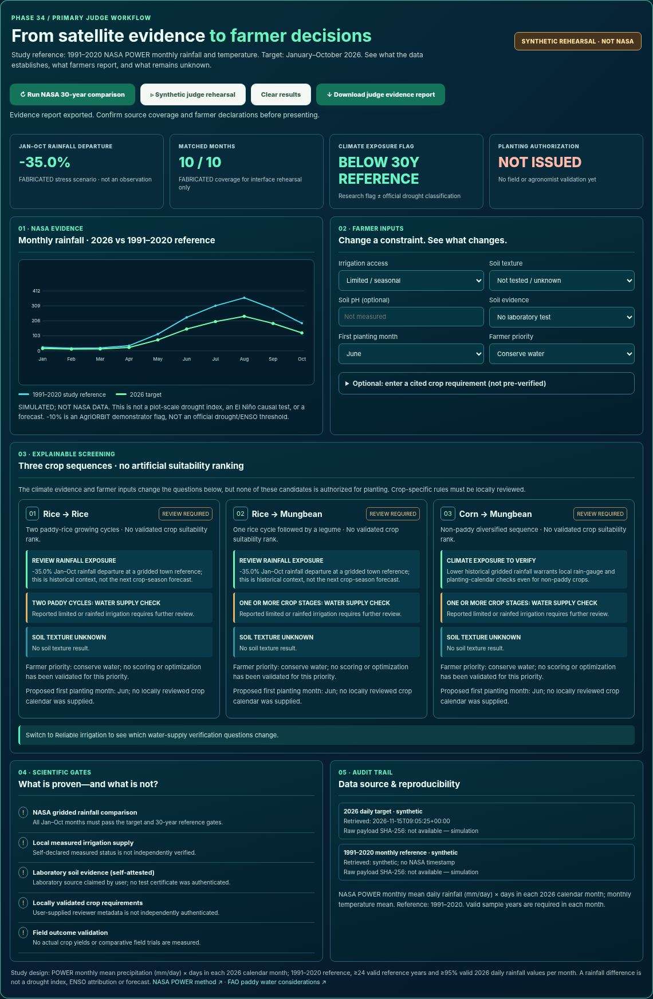
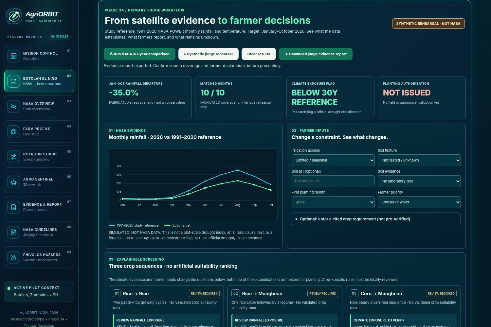

# AgriORBIT — Phase 42 | NASA Field Shift

**NASA Space Apps Challenge 2026 — Field Shift: Adapting Farms with NASA Data**  
**A climate-evidence and crop-rotation decision-support prototype for Botolan, Zambales, Philippines.**

> **Research prototype, not an operational planting recommendation or weather forecast.** NASA API connectivity and field-level accuracy must be verified on the demonstration computer. Screenshots may contain **synthetic example data**; no synthetic values are represented as observed NASA readings.



## What the prototype does

AgriORBIT connects historical **NASA POWER** meteorological estimates to questions farmers can explore before selecting a crop rotation. Its original interactive mission-control dashboard, cinematic boot, animations, and 3D rover visuals are preserved. A separate **Phase 42 scientific workspace** compares three unranked rotation scenarios:

- Rice → Rice
- Rice → Mungbean
- Corn → Mungbean

For a selected planting month and crop timings, the tool summarizes **historical 2015–2024 planting cohorts** using rainfall totals, rainfall per occupied crop day, reference evapotranspiration (ETo), historical dry-spell context and P10/median/P90 sample variability. It also records farmer-entered irrigation and soil context and raises questions requiring field verification. It **does not rank the three options as scientifically validated 'best' choices**.



## Why NASA data matters

- **Source:** NASA POWER daily point meteorological service; historical gridded estimates rather than directly measured plot conditions.
- **Quality gates:** request metadata, units, daily completeness, physical consistency, source URL, timestamp and raw-response SHA-256 receipt.
- **Failure behavior:** NASA retrieval failure is not silently replaced with synthetic data. Cached NASA responses retain their original fetch time and are distinguished from new retrievals.
- **Water modeling:** FAO-56 reference ETo is estimated where inputs pass checks. Crop ETc is withheld unless complete, sourced growth-stage crop coefficients are supplied; even when calculated, ETc **is not irrigation demand**.

The separate scientific page uses NASA POWER for meteorological evidence. The **original preserved dashboard also includes older optional prototype modules and external reference links**; do not characterize the entire legacy app as NASA-only.

## Run locally (Windows PowerShell)

Requirements: Python 3.10+ and internet for real NASA API requests.

```powershell
py -m pip install -r requirements.txt
py START_AGRIORBIT_PHASE42.py
```

If `py` is unavailable, replace it with `python`. Close any other server on port `8034` first.

- **Original 3D mission-control dashboard:** http://127.0.0.1:8034/?force-15=1#botolan
- **NASA scientific comparison:** http://127.0.0.1:8034/science
- **Server health:** http://127.0.0.1:8034/api/health

In the scientific workspace select **Real NASA POWER** to attempt an actual retrieval. **Synthetic Rehearsal** is for offline interface demonstration only. An online connection is required for a fresh NASA response.

## Evidence and limitations

- Historical climate exposure is **not** a future-season forecast, yield prediction, planting authorization, or on-farm rain gauge.
- P10/P90 describe historical sample variation, **not** forecast probabilities or confidence limits.
- Farmer-entered soil, irrigation and crop-coefficient data are **not independently verified**.
- Crop ETc excludes effective rainfall, actual irrigation distribution, rice-field ponding, seepage and percolation. **No measured water savings or improved farmer outcomes are claimed.**
- Live NASA retrieval, external agronomist review, soil tests, farmer field trials and on-farm impact remain to be demonstrated and documented.

Read [Phase 42 scientific limitations and QA](docs/PHASE42_JUDGE_VALIDATION.md), [Phase 41 method notes](docs/PHASE41_SCIENCE_VALIDATION.md), [publishing/rights checklist](docs/PUBLIC_RELEASE_CHECKLIST.md) and the [original Phase 34 README](docs/README_ORIGINAL_PHASE34.md).

## Tests

```powershell
py -m pytest -q
```

Automated regression testing in the development environment reported **232 passing tests** for Phase 42; this is not an independent verification of live NASA connectivity or agronomic outcomes.

## External references and acknowledgments

1. [NASA Space Apps 2026 — Field Shift: Adapting Farms with NASA Data](https://www.spaceappschallenge.org/2026/challenges/field-shift-adapting-farms-with-nasa-data/)
2. [NASA POWER Daily Point API](https://power.larc.nasa.gov/docs/services/api/temporal/daily/)
3. [NASA POWER methodology and hydrological data sources](https://power.larc.nasa.gov/docs/methodology/data/sources_hydrology/)
4. [FAO Irrigation and Drainage Paper 56 — Crop evapotranspiration](https://www.fao.org/4/X0490E/x0490e00.htm)
5. [FAO — Irrigation water needs including rice](https://www.fao.org/4/s2022e/s2022e08.htm)

This independent hackathon prototype is **not affiliated with or endorsed by NASA**. Contributor names, asset permissions, dependency licenses and competition disclosure are subject to team confirmation before public release. **No open-source license has been granted with this GitHub-ready preparation.**
